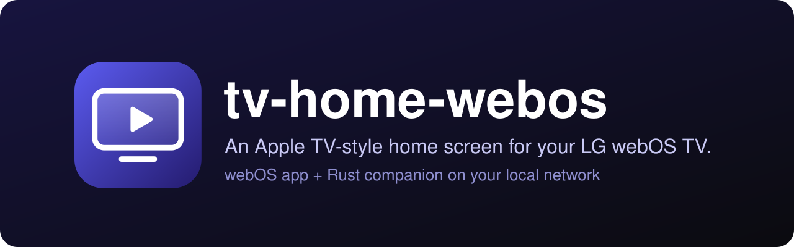
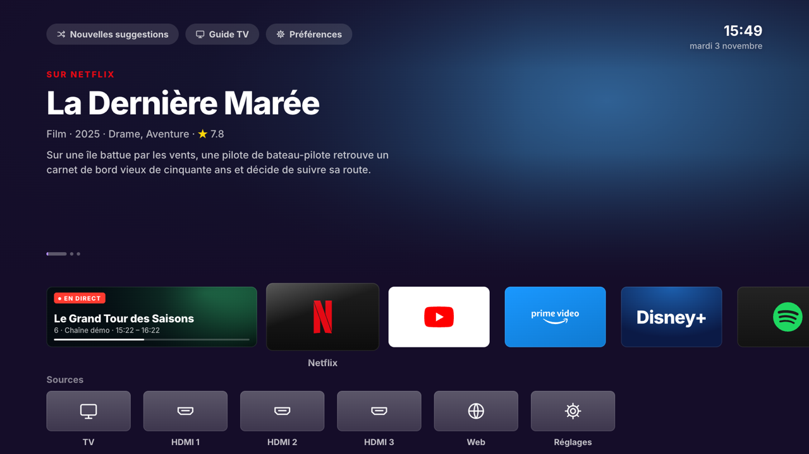
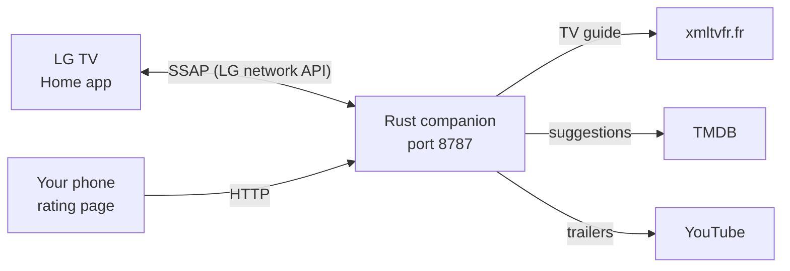

<div align="center">

[](README.md)


# tv-home-webos

**An Apple TV-style home screen for your LG webOS TV, ad-free.**<br>
An app on the TV, plus a small Rust service on your local network that opens the home screen when the TV turns on, knows what is playing and suggests what to watch.

[](LICENSE)
[](#requirements)
[](companion)
[](https://www.themoviedb.org)
[](AGENTS.md)

</div>

<p align="center"></p>

https://github.com/user-attachments/assets/9ecd0bcb-9972-40c4-85ff-049480bb9e3e

<p align="center"></p>

## Why

The stock LG home screen is full of ads and banners. tv-home-webos replaces it with a clean, Apple TV-style screen: your apps as large tiles, the current channel, movie and series suggestions. Tested on an LG 43UP80006LR (webOS 6).

There are two parts:

- `app/`: the webOS app (HTML, CSS, JS), installed in developer mode.
- `companion/`: a Rust service (tokio + axum) that runs all the time on a server of your local network (an old Linux laptop is enough).

Unofficial project, not affiliated with LG Electronics.

## How it works



The companion:

- opens the Home app when the TV turns on (and, optionally, instead of the LG home) through LG's official network API (SSAP);
- remembers the last channel and the apps that were opened;
- fetches the French DTT TV guide (xmltvfr.fr) for the Live TV card;
- suggests movies and series (TMDB) from your ratings (Like / Interested / Pass / Not seen), filtered and ranked by your streaming services;
- can redirect the home button to the Home app;
- serves a web page to rate titles from your phone: `http://<server-ip>:8787`.

## Installation

```sh
curl -fsSL https://raw.githubusercontent.com/pyxl-dev/tv-home-webos/main/install.sh | sh
```

The installer puts the code in `~/.local/share/tv-home-webos`, creates your two config files from their templates (never overwriting yours), builds the companion (`cargo`), packages the TV app (`ares-package`) and, on Linux with systemd, writes the `tv-home-companion.service` user unit without enabling it. Re-run it to update. `--uninstall` removes the unit and the build files, and keeps the folder if it holds your config, pairing key or ratings. It only touches your home folder and never the TV.

Four steps remain, and they are yours to do.

**1. Configure.** Two local, unversioned files, created from their templates (the installer already does it):

```sh
cp app/config.example.js app/config.js                    # companion address, as seen by the TV
cp companion/tv-home.env.example companion/tv-home.env    # TV IP and MAC
```

The companion refuses to start without `TVHOME_TV_IP`. Give the TV and the server a fixed IP in your router. `TVHOME_TV_MAC` is for Wake-on-LAN and needs "Turn on via Wi-Fi" enabled on the TV. For suggestions, put your TMDB key (v3, or a v4 read token starting with `eyJ`) in `companion/data/settings.json`: `{"tmdbKey": "your-key"}`. Without a key everything works except suggestions.

**2. Install the app on the TV** (developer mode on, `ares-cli` device declared, here named `lg-tv`):

```sh
ares-package app -o dist && ares-install -d lg-tv dist/*.ipk
```

**3. Run the companion** on the server, as a systemd user service (linger enabled so it runs without an open session):

```sh
cd ~/tv-home/companion && cargo build --release
mkdir -p ~/.config/systemd/user && ln -sf ~/tv-home/companion/tv-home-companion.service ~/.config/systemd/user/
systemctl --user daemon-reload && systemctl --user enable --now tv-home-companion
```

`tv-home-companion.service` expects the repository in `~/tv-home`; adjust the paths if it lives elsewhere (the installer does it for you). The service reads `companion/tv-home.env`.

**4. Pair.** On first start, accept the pairing prompt on the TV with the real remote.

### Let your AI agent handle it

Paste this into Claude Code, Codex, Cursor or any agent with terminal access:

```text
Install tv-home-webos: https://github.com/pyxl-dev/tv-home-webos
Follow the AGENTS.md file in that repository.
```

[`AGENTS.md`](AGENTS.md) tells the agent how to install it, which steps to leave to you (TV IP, pairing, TMDB key) and the safety rules.

### Requirements

| | Used for |
| --- | --- |
| An LG webOS TV with [developer mode](https://webostv.developer.lge.com/develop/getting-started/developer-mode-app) | hosting the app (tested on webOS 6) |
| [`ares-cli`](https://webostv.developer.lge.com/develop/tools/cli-installation) (`npm install -g @webos-tools/cli`) | packaging and installing the app, debugging |
| [Rust](https://rustup.rs) (`cargo`) | building the companion |
| An always-on server on the same network as the TV | running the companion (systemd for the provided service) |
| A fixed IP for the TV and the server | so the address never changes |
| A free [TMDB](https://www.themoviedb.org/settings/api) key | movie and series suggestions |
| [Node.js](https://nodejs.org) 22+ | only for `tools/tv.mjs` |

## Usage

- **On the TV**: the Home app opens when the TV turns on. Add apps from "Ajouter" (the ones the TV has opened at least once).
- **On the phone**: open `http://<server-ip>:8787` to rate titles (Like / Interested / Pass / Not seen), see the TV guide and set reminders, pick your services and a theme, tune the companion and drive the TV (power, volume, channels, arrows). The page can be added to the home screen like an app.
- **Settings**: home button redirect, automatic refresh, seasonal picks (Halloween, Christmas...), titles outside your services, TV programme reminder lead time.

Companion environment variables:

| Variable | Purpose |
| --- | --- |
| `TVHOME_TV_IP` | TV address (required) |
| `TVHOME_TV_MAC` | MAC address, for Wake-on-LAN (optional) |
| `TVHOME_PORT` | web page port (`8787` by default) |
| `TVHOME_NO_TV=1` | run without talking to the TV (to test on a copy of `data/`, with `TVHOME_PORT`) |

Logs: `tail -f ~/tv-home/companion/companion.log` on the server.

### Deploy a change from another machine

Replace `server.local` with your server's name:

```sh
rsync -az --exclude target --exclude dist --exclude companion.log --exclude companion/data ./ server.local:~/tv-home/
ssh server.local 'cd ~/tv-home/companion && ~/.cargo/bin/cargo build --release && systemctl --user daemon-reload && systemctl --user restart tv-home-companion'
```

### Test on the TV

`node tools/tv.mjs` can: screenshot the real screen, screenshot the app at 1920x1080, run JS in the app, send remote keys, click a button by its name, turn the TV off. Run it with no argument for help. It reads the TV address from `companion/tv-home.env`.

## Security

- The companion and its rating page have no authentication: they are meant for a trusted local network. Do not expose them to the Internet.
- These files are personal and never committed: `app/config.js`, `companion/tv-home.env`, `companion/client-key.txt` (the TV pairing key) and `companion/data/` (TMDB key, ratings, cache).
- Pairing goes through the prompt shown on the TV: you need the real remote to accept it.

## Development

```sh
git clone https://github.com/pyxl-dev/tv-home-webos && cd tv-home-webos
./install.sh    # installs this clone
```

| File | |
| --- | --- |
| `app/` | the webOS app (`index.html`, `apps.js` for tile styles, `logos/`, `fonts/`) |
| `app/config.example.js` | template for `app/config.js` |
| `companion/src/` | the Rust companion (`tv.rs` SSAP, `epg.rs` guide, `suggest.rs` suggestions, `http.rs` API and pages) |
| `companion/public/` | the rating and remote page, the player, the PWA |
| `companion/tv-home.env.example` | template for `companion/tv-home.env` |
| `companion/tv-home-companion.service` | systemd user unit |
| `companion/manifest.json` | SSAP pairing manifest |
| `tools/tv.mjs` | test and capture tool for the TV |
| `install.sh` | installer |
| `AGENTS.md` | instructions for any AI agent |

## License

Code under the [MIT](LICENSE) license.

- The Inter font (`app/fonts/`) is under the SIL Open Font License 1.1 (see `app/fonts/OFL.txt`).
- The logos in `app/logos/` (Netflix, YouTube, Spotify, TF1+, etc.) are trademarks of their owners. They are not covered by the MIT license and only identify the applications on the TV.
- Unofficial project, not affiliated with LG Electronics.

Made with Claude.
