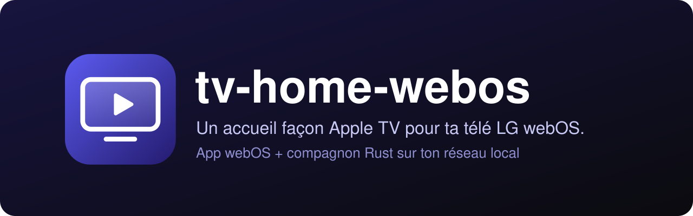
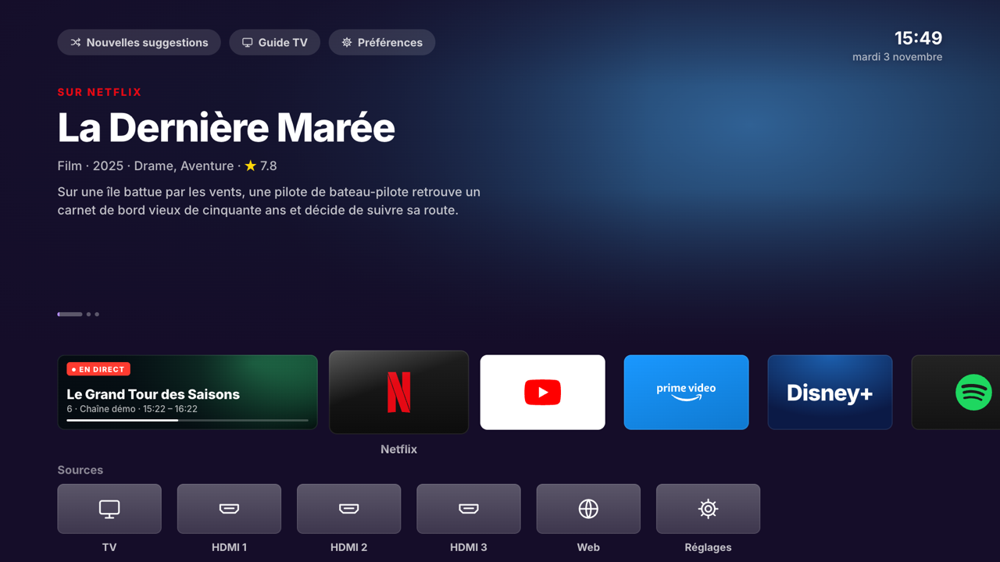
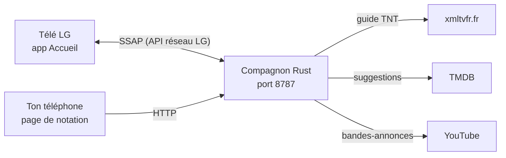

<div align="center">

[](README.en.md)


# tv-home-webos

**Un accueil façon Apple TV pour ta télé LG webOS, sans pubs.**<br>
Une app sur la télé, un petit service Rust sur ton réseau local qui ouvre l'accueil à l'allumage, sait ce qui passe à la télé et te suggère quoi regarder.

[](LICENSE)
[](#prérequis)
[](companion)
[](https://www.themoviedb.org)
[](AGENTS.md)

</div>

<p align="center"></p>

https://github.com/user-attachments/assets/9ecd0bcb-9972-40c4-85ff-049480bb9e3e

<p align="center"></p>

## Pourquoi

L'accueil d'origine d'une télé LG est plein de pubs et de bandeaux. tv-home-webos le remplace par un écran propre, façon Apple TV : tes apps en grandes tuiles, la chaîne en cours, des suggestions de films et séries. Testé sur une LG 43UP80006LR (webOS 6).

Il y a deux morceaux :

- `app/` : l'app webOS (HTML, CSS, JS), installée en mode développeur.
- `companion/` : un service Rust (tokio + axum) qui tourne en permanence sur un serveur du réseau local (un vieux portable sous Linux fait l'affaire).

Projet non officiel, sans lien avec LG Electronics.

## Comment ça marche



Le compagnon :

- ouvre l'Accueil à l'allumage de la télé (et, en option, à la place de l'accueil LG) via l'API réseau officielle de LG (SSAP) ;
- mémorise la dernière chaîne et les apps ouvertes ;
- récupère le guide TV TNT (xmltvfr.fr) pour la carte Live TV ;
- propose des suggestions de films et séries (TMDB) selon tes notes (J'aime / Intéressé / Passe / Pas vu), filtrées et priorisées selon tes plateformes ;
- peut rediriger le bouton maison vers l'Accueil ;
- sert une page web pour noter depuis le téléphone : `http://<ip-du-serveur>:8787`.

## Installation

```sh
curl -fsSL https://raw.githubusercontent.com/pyxl-dev/tv-home-webos/main/install.sh | sh
```

L'installateur met le code dans `~/.local/share/tv-home-webos`, crée tes deux fichiers de configuration à partir de leurs modèles (sans jamais écraser les tiens), compile le compagnon (`cargo`), empaquette l'app TV (`ares-package`) et, sous Linux avec systemd, écrit l'unité utilisateur `tv-home-companion.service` sans l'activer. Relance-le pour mettre à jour. `--uninstall` retire l'unité et les fichiers compilés, et garde le dossier s'il contient ta config, ta clé de jumelage ou tes notes. Il ne touche qu'à ton dossier perso et jamais à la télé.

Il reste ensuite quatre étapes à faire toi-même.

**1. Configurer.** Deux fichiers locaux, non versionnés, créés depuis leur modèle (l'installateur le fait déjà) :

```sh
cp app/config.example.js app/config.js                    # adresse du compagnon vue par la télé
cp companion/tv-home.env.example companion/tv-home.env    # IP et MAC de la télé
```

Le compagnon refuse de démarrer sans `TVHOME_TV_IP`. Donne une IP fixe à la télé et au serveur dans la box. `TVHOME_TV_MAC` sert au Wake-on-LAN et demande l'option « Allumer via Wi-Fi » sur la télé. Pour les suggestions, mets ta clé TMDB (v3, ou jeton de lecture v4 qui commence par `eyJ`) dans `companion/data/settings.json` : `{"tmdbKey": "ta-cle"}`. Sans clé, tout marche sauf les suggestions.

**2. Installer l'app sur la télé** (mode développeur activé, appareil `ares-cli` déclaré, ici nommé `lg-tv`) :

```sh
ares-package app -o dist && ares-install -d lg-tv dist/*.ipk
```

**3. Lancer le compagnon** sur le serveur, en service systemd utilisateur (linger activé pour qu'il tourne sans session ouverte) :

```sh
cd ~/tv-home/companion && cargo build --release
mkdir -p ~/.config/systemd/user && ln -sf ~/tv-home/companion/tv-home-companion.service ~/.config/systemd/user/
systemctl --user daemon-reload && systemctl --user enable --now tv-home-companion
```

Le fichier `tv-home-companion.service` suppose le dépôt dans `~/tv-home` ; adapte les chemins s'il est ailleurs (l'installateur le fait pour toi). Le service lit `companion/tv-home.env`.

**4. Jumeler.** Au premier lancement, accepte le jumelage sur la télé avec la vraie télécommande.

### Laisse ton agent IA s'en occuper

Colle ceci dans Claude Code, Codex, Cursor ou n'importe quel agent qui a accès à un terminal :

```text
Installe tv-home-webos : https://github.com/pyxl-dev/tv-home-webos
Suis le fichier AGENTS.md de ce dépôt.
```

[`AGENTS.md`](AGENTS.md) explique à l'agent comment l'installer, quelles étapes te laisser (IP de la télé, jumelage, clé TMDB) et les règles de sécurité. Il est en anglais, la langue que tous les agents lisent.

### Prérequis

| | Sert à |
| --- | --- |
| Une télé LG webOS avec le [mode développeur](https://webostv.developer.lge.com/develop/getting-started/developer-mode-app) | héberger l'app (testé sur webOS 6) |
| [`ares-cli`](https://webostv.developer.lge.com/develop/tools/cli-installation) (`npm install -g @webos-tools/cli`) | empaqueter et installer l'app, déboguer |
| [Rust](https://rustup.rs) (`cargo`) | compiler le compagnon |
| Un serveur toujours allumé sur le même réseau que la télé | faire tourner le compagnon (systemd pour le service fourni) |
| Une IP fixe pour la télé et le serveur | que l'adresse ne change pas |
| Une clé [TMDB](https://www.themoviedb.org/settings/api) (gratuite) | les suggestions de films et séries |
| [Node.js](https://nodejs.org) 22+ | seulement pour `tools/tv.mjs` |

## Utilisation

- **Sur la télé** : l'Accueil s'ouvre à l'allumage. Les apps s'ajoutent depuis « Ajouter » (celles que la télé a déjà ouvertes une fois).
- **Sur le téléphone** : ouvre `http://<ip-du-serveur>:8787` pour noter des titres (J'aime / Intéressé / Passe / Pas vu), voir le guide TNT et programmer des rappels, choisir tes plateformes et un thème, régler le compagnon et piloter la télé (allumer, éteindre, volume, chaînes, flèches). La page peut s'ajouter à l'écran d'accueil comme une app.
- **Réglages** : redirection du bouton maison, rafraîchissement automatique, titres de saison (Halloween, Noël...), titres hors de tes plateformes, délai de rappel des programmes TNT.

Variables d'environnement du compagnon :

| Variable | Rôle |
| --- | --- |
| `TVHOME_TV_IP` | adresse de la télé (obligatoire) |
| `TVHOME_TV_MAC` | adresse MAC, pour le Wake-on-LAN (facultatif) |
| `TVHOME_PORT` | port de la page web (`8787` par défaut) |
| `TVHOME_NO_TV=1` | tourne sans parler à la télé (pour tester sur une copie de `data/`, avec `TVHOME_PORT`) |

Logs : `tail -f ~/tv-home/companion/companion.log` sur le serveur.

### Déployer une modif depuis un autre poste

Remplace `serveur.local` par le nom du serveur :

```sh
rsync -az --exclude target --exclude dist --exclude companion.log --exclude companion/data ./ serveur.local:~/tv-home/
ssh serveur.local 'cd ~/tv-home/companion && ~/.cargo/bin/cargo build --release && systemctl --user daemon-reload && systemctl --user restart tv-home-companion'
```

### Tester sur la télé

`node tools/tv.mjs` fait : capture de l'écran réel, capture de l'app en 1920×1080, JS dans l'app, touches de télécommande, clic sur un bouton par son nom, extinction. Lance-le sans argument pour l'aide. Il lit l'IP de la télé dans `companion/tv-home.env`.

## Sécurité

- Le compagnon et sa page de notation n'ont pas d'authentification : ils sont faits pour un réseau local de confiance. Ne les expose pas sur Internet.
- Ces fichiers sont personnels et ne sont jamais versionnés : `app/config.js`, `companion/tv-home.env`, `companion/client-key.txt` (clé de jumelage de la télé) et `companion/data/` (clé TMDB, notes, cache).
- Le jumelage passe par l'invite affichée sur la télé : il faut la vraie télécommande pour l'accepter.

## Développement

```sh
git clone https://github.com/pyxl-dev/tv-home-webos && cd tv-home-webos
./install.sh    # installe ce clone
```

| Fichier | |
| --- | --- |
| `app/` | l'app webOS (`index.html`, `apps.js` pour le style des tuiles, `logos/`, `fonts/`) |
| `app/config.example.js` | modèle de `app/config.js` |
| `companion/src/` | le compagnon Rust (`tv.rs` SSAP, `epg.rs` guide, `suggest.rs` suggestions, `http.rs` API et pages) |
| `companion/public/` | la page de notation et télécommande, le lecteur, la PWA |
| `companion/tv-home.env.example` | modèle de `companion/tv-home.env` |
| `companion/tv-home-companion.service` | unité systemd utilisateur |
| `companion/manifest.json` | manifeste de jumelage SSAP |
| `tools/tv.mjs` | outil de test et de capture sur la télé |
| `install.sh` | installateur |
| `AGENTS.md` | instructions pour n'importe quel agent IA |

## Licence

Code sous licence [MIT](LICENSE).

- La police Inter (`app/fonts/`) est sous SIL Open Font License 1.1 (voir `app/fonts/OFL.txt`).
- Les logos de `app/logos/` (Netflix, YouTube, Spotify, TF1+, etc.) sont des marques de leurs propriétaires. Ils ne sont pas couverts par la licence MIT et servent seulement à identifier les applications sur la télé.
- Projet non officiel, sans lien avec LG Electronics.

Créé avec Claude.
